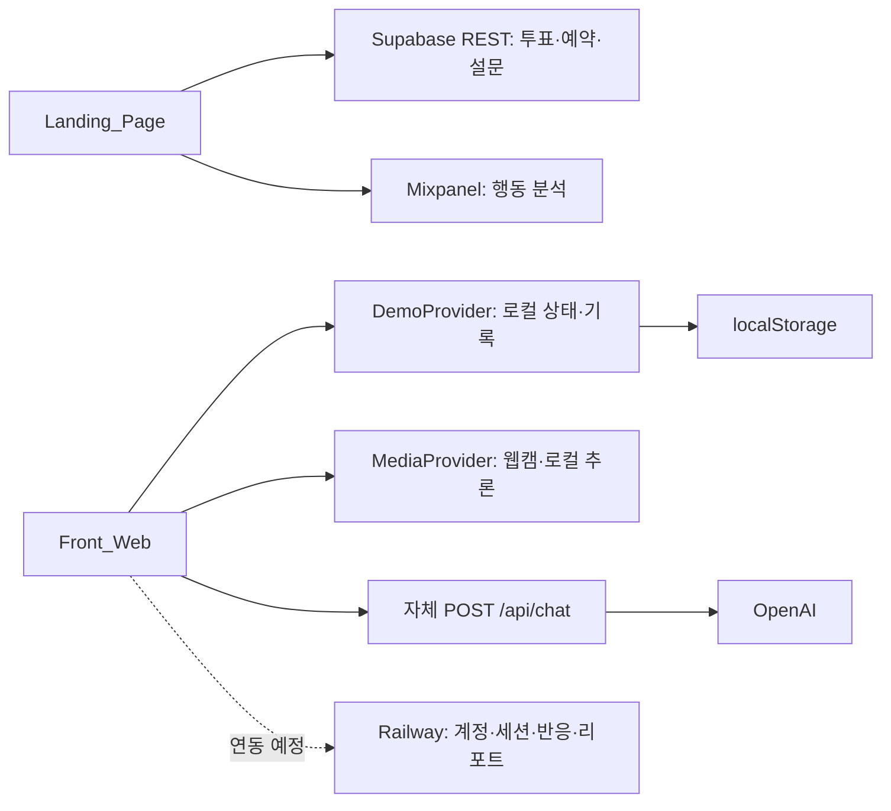

# CAPSULE 프로젝트 개요

확인일: **2026-11-05 (Asia/Seoul)**. 코드 기준: `Front_Web`의 `6355f31`, `Landing_Page`의 `c73c52f`.

CAPSULE은 AI 캐릭터와 함께 공부하며 웹캠에서 관측한 상태에 따라 캐릭터가 반응하는 웹 서비스다. 현재 작업 폴더에는 **실제 공부 앱의 프런트 데모**, **수요 검증용 랜딩 앱**, **3D 제작 원본**이 있다. 제공받은 Railway 백엔드 소스는 이 작업 폴더에 없으며, 공개 [Swagger](https://backendlab-production-3052.up.railway.app/swagger-ui/index.html#/)와 [OpenAPI](https://backendlab-production-3052.up.railway.app/v3/api-docs)로 계약을 확인했다.

## 1. 저장소와 앱의 역할

| 위치 | 역할 | 현재 데이터·외부 연결 |
|---|---|---|
| `Front_Web/` | 로그인·온보딩·룸·공부·리포트·캡슐 카드 | React Context/reducer + localStorage. 선택형 LLM 채팅만 자체 `/api/chat` 서버에 연결 |
| `Landing_Page/` | 소개·스터디룸 투표·이메일 사전예약·후속 설문 | 브라우저 → Supabase REST, 행동 분석 → Mixpanel |
| 루트의 `.blend`·`.glb`, `macbook_web_ready_notes/` | 랜딩 MacBook 연출의 제작 원본·관련 자료 | 앱 런타임과 별도. 실제 랜딩 모델 참조는 `Landing_Page/src/components/macbook/`에서 관리 |
| 외부 Railway 백엔드 | 계정·약관·프로필·일정·세션·캐릭터 반응·정산 API | 현재 `Front_Web`에서 호출하지 않음. [전체 API 정리](BACKEND_API.md) 참고 |

작업 폴더 `studywithme/` 자체는 Git 저장소가 아니다. `Front_Web/`와 `Landing_Page/`가 각각 독립 Git 저장소이며 `package.json`, 의존성, 실행·배포 설정도 분리되어 있다. 일부 이미지·폰트의 출처를 공유하지만 런타임에 상대 앱의 소스를 import하는 구조는 아니다.



## 2. Front_Web의 현재 제품 흐름

```text
/login → /onboarding → / → /rooms/:roomId
  → /rooms/:roomId/prepare → /study/:sessionId
  → /reports/:recordId → /capsules/:recordId → 홈·다음 약속
```

현재 실행 경로의 근거는 [App.tsx](../src/app/App.tsx), MVP 정책의 근거는 [policy.ts](../src/features/mvp/policy.ts)다.

- 실제 시연 룸은 `dawn-library`, 캐릭터는 `chaerin`(채린)이다. 나머지 룸은 표시되지만 공부 진입을 제한한다.
- 목표 선택 UI의 값과 별개로 `START_MVP`가 **3분(180초)** 세션을 만든다. 대화 옵션·유료 기능은 MVP 범위에서 제한한다.
- 목표에 도달해도 공부는 계속된다. 사용자가 **쉬는 시간**을 누르면 10분 휴식으로 바뀌고, 휴식 종료 또는 이어 공부하기로 누적 공부를 재개한다.
- 준비 화면은 목표·일정 화면이다. 현재 코드는 공부 화면의 독에서 카메라·마이크를 켠다. 새 MVP 세션은 카메라를 끈 상태로 시작한다.
- `/records`, `/characters/*`, `/credits/*`는 `MvpUnavailablePage`로 연결된다. 기존 기능 코드와 데모 데이터가 남아 있어도 현재 공개 동선의 활성 기능을 뜻하지 않는다.
- 마이페이지 프로필·공통 일정, 종료 리포트, 캡슐 카드 PNG 저장·공유는 유지한다.

과거 README·기획 문서의 카메라 준비 단계, 일시정지, 목표 후 자동 휴식 설명은 현재 코드와 일부 다르다. 현재 상태를 판단할 때 `App.tsx`, `PreparePage.tsx`, `demo/reducer.ts`, `mvp/policy.ts`를 우선한다. 11/1의 말포이 단일 입장 PRD 검토는 당시 요구와 구현의 차이를 기록한 문서이며, 현재 채린 MVP가 그 PRD를 모두 구현했다는 근거가 아니다.

## 3. Front_Web의 코드 경계

| 위치 | 책임·수정 지점 |
|---|---|
| [src/main.tsx](../src/main.tsx) | `BrowserRouter → DemoProvider → MediaProvider → App` 구성, 스타일 계층 초기화 |
| [src/app/App.tsx](../src/app/App.tsx) | 화면 라우트·지연 로딩·로컬 데모 진입 가드 |
| `src/pages/` | URL별 화면과 사용자 행동 조합 |
| [features/demo/types.ts](../src/features/demo/types.ts) | 프런트 화면용 프로필·세션·기록·메시지·일정 타입 |
| [features/demo/reducer.ts](../src/features/demo/reducer.ts) | 로컬 로그인·세션·휴식·종료·메시지·일정 상태 전이 |
| [features/demo/DemoProvider.tsx](../src/features/demo/DemoProvider.tsx), [persistence.ts](../src/features/demo/persistence.ts) | 상태 공유, 1초 TICK, `capsule-wireframe-demo:v1` 저장·복구·이전 |
| [features/rooms/services/room-service.ts](../src/features/rooms/services/room-service.ts) | 정적 룸·인물 콘텐츠와 이미지 결합. 서버 조회로 교체할 경계 |
| `features/session/` | 공부 UI·타이머·채팅·상호작용과 감지 후 발화 판단 |
| `features/media/` | 장치 수명, 웹워커 추론, 얼굴 기반 관측 집계, 가상 배경 |
| `features/reports/` | 종료 화면·레벨 진행·기간 기록·캡슐 카드 합성/내보내기 |
| `features/characters/` | 인물 이미지·공부 레벨·호감도 표시·콘텐츠 해금 표현 |
| `features/schedule/` | 모든 캐릭터가 공유하는 일정·달력·편집 |
| `src/shared/ui/`, `src/shared/lib/` | 공통 UI와 날짜·숫자·접근성 도구 |
| [server/openai-chat.ts](../server/openai-chat.ts), [server/worker.ts](../server/worker.ts) | 자체 LLM 프록시, 배포 시 정적 파일 제공 |

### 상태와 시간

`DemoProvider`는 `useReducer` 상태를 브라우저에 저장한다. 실제 API 사용자 인증이나 서버 기록 캐시가 아니다. 세션 ID는 `session-<시각>` 형태의 문자열이며, 룸·캐릭터도 문자열 콘텐츠 ID를 사용한다.

시간 표시는 interval 실행 횟수가 아니라 누적 경과와 `Date.now() - runningSince`로 계산한다. `TAKE_BREAK`가 공부 시간을 고정하고, `CONTINUE_STUDY`가 같은 세션을 이어가며, `FINISH`가 로컬 기록을 추가한다. `RESUME_SESSION`은 구형 저장 데이터의 멈춘 타이머 복구용이다. 서버의 비정상 종료 후 `resume`과 의미가 다르다.

공부 레벨은 데모 기준 600분마다 증가하는 Lv.1~5다. 호감도는 별도의 0~100 확정 점수이며, 프런트에서 공부 시간·메시지 수·선물로 임의 적립하지 않는다. `SET_AFFECTION`이 확정 점수를 반영하는 경계이며, 값이 없으면 `— / 100`을 표시한다. 서버의 `points`, `stage`, `level`과 연결할 때는 의미와 범위를 확인해야 한다.

### 웹캠과 캐릭터 반응

[MediaProvider.tsx](../src/features/media/MediaProvider.tsx)가 장치와 워커를 관리한다. Face Landmarker, Gesture Recognizer, Object Detector를 사용하고, 얼굴·손·핸드폰을 다른 주기로 처리한다. 카메라 영상·얼굴 좌표는 로컬에서 처리하며 현재 채팅 요청에는 감지 상황을 텍스트로 전달한다.

[behavior-constants.ts](../src/features/media/behavior-constants.ts)의 현재 주요 기준은 자리 비움 3초, 졸음 2초, 하품 1초, 고개 돌림 25도·2초, 핸드폰 3회 연속 검출이다. [behavior-chat.ts](../src/features/session/behavior-chat.ts)는 같은 감지 종류 60초·전체 20초의 발화 간격을 적용하고, 자리 비움은 돌아왔을 때 반응한다. 이는 **현재 프런트 규칙**이며 Swagger가 확정한 서버 이벤트 코드·정책으로 취급하지 않는다.

### 채팅과 인증의 현재 구현

[llm-chat.ts](../src/features/session/llm-chat.ts)는 `POST /api/chat`으로 `{ userName, room, character, phase, elapsedMinutes, goalMinutes, history, text }`를 보내고 `{ reply }`를 받는다. 서버는 입력 최대 500자·최근 이력 12건을 처리한다. Railway의 세션 메시지 API는 최대 300자이며 응답 구조도 달라 URL 교체만으로 연결되지 않는다.

이메일 인증은 [EmailVerificationForm.tsx](../src/features/auth/components/EmailVerificationForm.tsx)의 명시적인 화면 확인용 흐름이다. [PasswordRecoveryForm.tsx](../src/features/auth/components/PasswordRecoveryForm.tsx)는 API 미연결 안내를 표시한다. 실제 메일 발송·가입·로그인·카카오 OAuth·토큰 갱신은 별도 연결이 필요하다.

## 4. Landing_Page의 흐름과 데이터

현재 [App.tsx](../../Landing_Page/src/App.tsx)는 랜딩 → `/rooms` → `/preorder` → `/done`, 이후 선택 설문 `/survey` → `/done`을 관리한다. [useRoute.ts](../../Landing_Page/src/hooks/useRoute.ts)는 History API·View Transitions·초점·스크롤 복원을 담당한다.

[src/lib/api.ts](../../Landing_Page/src/lib/api.ts)는 Supabase REST에 `landing_vote`, `landing_preorder`, `landing_survey`를 저장하고 `landing_vote_total()`로 투표자를 집계한다. 처음 저장한 투표와 예약할 룸은 구분한다. 예약할 룸을 바꿔도 기존 투표는 바꾸지 않는다. 중복 이메일은 기존 예약이 유지됨을 안내하며, 저장 실패·설정 누락을 성공으로 표시하지 않는다.

예약·설문 초안은 탭의 React 상태에 있어 새로고침하면 초기화된다. 제출한 원본은 Supabase에 남고, 익명 방문자 ID는 브라우저 저장소에 보관한다. Mixpanel은 행동 분석용이며 이메일·자유 서술을 이벤트 속성에 넣지 않는다. 자세한 저장 규격과 마이그레이션 순서는 랜딩의 [frontend-schema.md](../../Landing_Page/docs/frontend-schema.md), [data-collection.md](../../Landing_Page/docs/data-collection.md)에 있다.

랜딩 첫 화면은 [MacBook 연출](../../Landing_Page/docs/MACBOOK_LANDING.md)을 사용한다. `package.json`과 실제 코드에는 Three.js·React Three Fiber·Drei·GSAP이 있으며, 오래된 README의 “애니메이션 라이브러리 없이 구현”은 현재 3D Hero 전체에는 적용되지 않는다. 모델 안 서비스 화면은 이미지 텍스처로, 실제 `Front_Web` 세션을 표시하는 구조가 아니다.

## 5. 디자인·실행·배포

Front_Web은 React 19·TypeScript·Vite·React Router·Tailwind v4, GSAP·Motion을 사용한다. 디자인 원본은 [DESIGN_TOKENS.json](DESIGN_TOKENS.json), 사용 기준은 [DESIGN_SYSTEM.md](DESIGN_SYSTEM.md)다. `tokens:sync`가 CSS·런타임 토큰을 생성하고 `tokens:check`로 일치 여부를 확인한다. 이미지 출처·생성 기록은 [src/assets/README.md](../src/assets/README.md), 상업 이용 검토는 [REFERENCE_COMMERCIAL_USE.md](REFERENCE_COMMERCIAL_USE.md)를 따른다.

| 항목 | Front_Web | Landing_Page |
|---|---|---|
| 설치·로컬 | Node `^22.13.0` 또는 `>=24`, `npm ci`, `npm run dev` | 별도 디렉터리에서 `npm ci`, `npm run dev` |
| 검사 | `npm run typecheck`, `npm run lint`, `npm run test`, `npm run build`, `npm run tokens:check` | `npm run lint`, `npm run build` |
| 설정 | `.env.example`의 서버용 `OPENAI_API_KEY`, 선택 `OPENAI_MODEL` | `.env.example`의 공개 Supabase·Mixpanel 설정 |
| 배포 설정 | [wrangler.jsonc](../wrangler.jsonc): Cloudflare Worker + `dist`, `/api/*` 우선 처리 | [vercel.json](../../Landing_Page/vercel.json): SPA rewrite |

두 앱은 별도 터미널에서 실행한다. 기본 포트가 겹치면 Vite 출력 주소를 확인한다. 실제 `.env.local`의 키 값은 이 문서에 복사하지 않았다.

## 6. 다음 백엔드 연동의 핵심

1. **인증 수명**: 데모 로그인 표시를 실제 토큰·갱신 쿠키·`/api/me`로 교체하고, 온보딩 여부·진행 세션으로 이동을 결정한다.
2. **서버 DTO와 화면 모델**: 숫자 ID, ISO 날짜, 완성형 아바타를 현재 문자열 ID·밀리초 시각·부분별 SVG 아바타와 명시적으로 매핑한다.
3. **세션 수명**: 생성·1분 heartbeat·상태 이벤트·복구·종료를 서버와 동기화한다. 로컬 `FINISH`만으로 서버 정산을 완료했다고 처리하지 않는다.
4. **반응 경로**: 감지 이벤트 저장 → `eventId` 기반 LLM 반응으로 연결하고, 일반 메시지는 별도 API로 보낸다. 현재 로컬 발화 제한과 서버 호감도 반영을 구분한다.
5. **결과 기준**: 집중률 분모·미측정·공부 레벨·호감도·목표 달성 판정을 계약에 맞춘다. 리포트에 없는 필드를 임의로 채우지 않는다.

세부 차이·누락된 정책·요청/응답 전체는 [BACKEND_API.md](BACKEND_API.md)에 정리했다. 이번 확인은 소스·문서와 공개 명세 조회 기준이며, 제품 런타임 변경·실계정 가입·세션 생성·결제·배포를 수행한 작업은 아니다.
